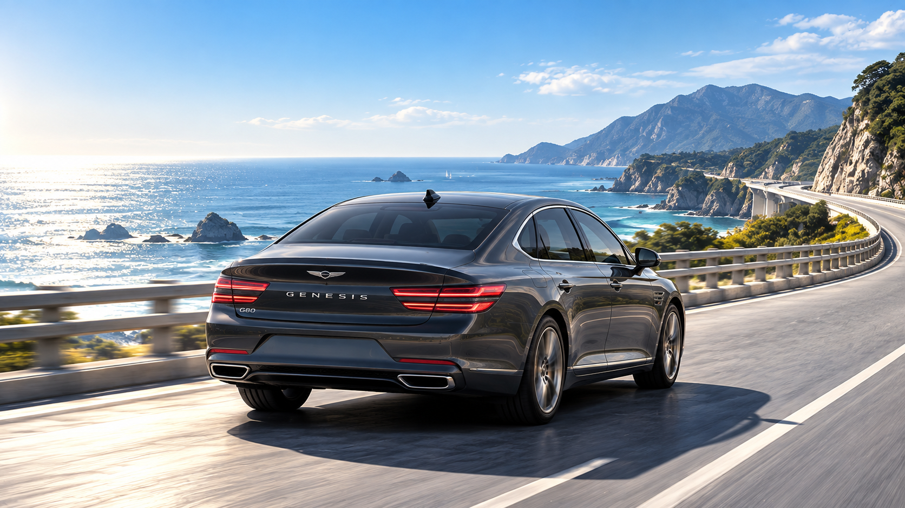
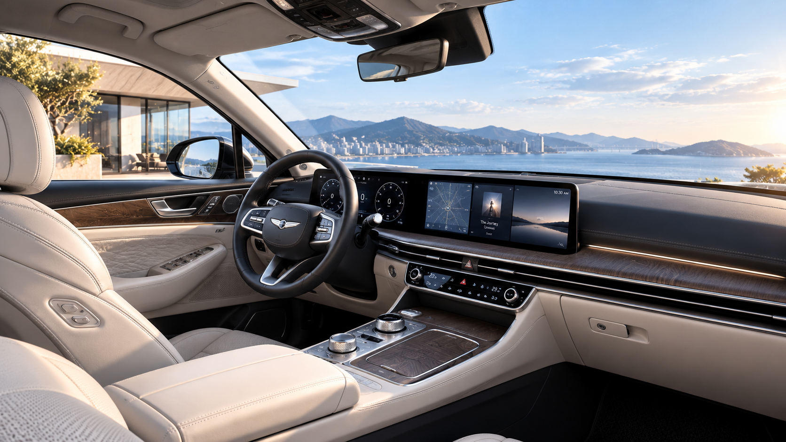

# GENESIS — Luxury Vehicle Showcase

> 제네시스의 브랜드 아이덴티티와 주요 라인업을 몰입감 있는 비주얼로 소개하는 반응형 웹 포트폴리오입니다.

<p align="center">
  
</p>

<p align="center">
  <a href="./index.html"><strong>프로젝트 실행하기</strong></a>
  &nbsp;·&nbsp;
  <a href="#주요-기능"><strong>주요 기능</strong></a>
  &nbsp;·&nbsp;
  <a href="#화면-구성"><strong>화면 구성</strong></a>
</p>

---

## 프로젝트 소개

GENESIS Luxury Vehicle Showcase는 G80, GV80, G90과 콘셉트카를 한눈에 살펴볼 수 있도록 제작한 브랜드형 웹사이트입니다. 메인 화면의 풀스크린 캐러셀에서 원하는 차량을 선택하면 각 모델의 전용 상세 페이지로 이동하며, 제원과 트림 정보를 확인할 수 있습니다.

고급스럽고 절제된 제네시스의 이미지를 표현하기 위해 대형 비주얼, 흑백 중심의 컬러, 여백을 활용했습니다. 별도의 프레임워크 없이 HTML, CSS, JavaScript만으로 인터랙션과 반응형 레이아웃을 구현했습니다.

## 제작 목표

- 대형 이미지 중심의 몰입감 있는 브랜드 경험 구현
- 차량별 핵심 정보가 명확하게 전달되는 화면 설계
- 데스크톱과 모바일 환경을 고려한 반응형 레이아웃 제작
- 캐러셀, 드래그, 패럴랙스 등 동적인 사용자 경험 구현

## 주요 기능

- **자동 재생 캐러셀** — 4초 간격으로 차량 이미지가 자동 전환됩니다.
- **다양한 탐색 방식** — 이전·다음 버튼, 도트 인디케이터, 마우스 드래그와 터치 스와이프를 지원합니다.
- **차량별 상세 페이지** — G80, GV80, G90, GENESIS CONCEPT의 제원과 트림 정보를 제공합니다.
- **패럴랙스 히어로** — 스크롤에 따라 배경 이미지가 움직여 깊이감 있는 화면을 연출합니다.
- **Go Top 버튼** — 상세 페이지를 탐색한 뒤 페이지 상단으로 부드럽게 이동할 수 있습니다.
- **반응형 디자인** — 화면 크기에 맞춰 타이포그래피, 그리드, 버튼 크기가 조정됩니다.

## 화면 구성

### Main — 모델 선택 캐러셀

대표 모델을 풀스크린 이미지로 보여주며, 클릭하면 해당 차량의 상세 페이지로 이동합니다.

<p align="center">
  
</p>

### Sub — GV80

역동적인 우아함을 강조한 럭셔리 SUV 상세 화면입니다.

<p align="center">
  
</p>

### Sub — G90

플래그십 세단의 고급스러운 이미지를 대형 비주얼로 표현했습니다.

<p align="center">
  
</p>

### Sub — GENESIS CONCEPT

제네시스가 제안하는 미래 모빌리티의 방향성을 보여주는 콘셉트 페이지입니다.

<p align="center">
  
</p>

## 사용 기술

| 구분 | 기술 | 활용 내용 |
| --- | --- | --- |
| Markup | HTML5 | 시맨틱 구조, 차량별 상세 페이지 구성 |
| Styling | CSS3 | 반응형 레이아웃, Grid, 애니메이션, 패럴랙스 스타일 |
| Interaction | JavaScript | 캐러셀, 드래그·터치, 자동 재생, 스크롤 이벤트 |

## 프로젝트 구조

```text
genesis_web_project/
├── index.html              # 메인 캐러셀 페이지
├── README.md               # 프로젝트 소개 문서
└── landing/
    ├── g80.html            # G80 상세 페이지
    ├── gv80.html           # GV80 상세 페이지
    ├── g90.html            # G90 상세 페이지
    ├── concept.html        # 콘셉트카 상세 페이지
    └── images/             # 차량 및 섹션 이미지
```

## 실행 방법

별도의 설치 과정 없이 저장소를 내려받은 뒤 `index.html`을 브라우저에서 열면 실행됩니다.

```bash
git clone <YOUR_REPOSITORY_URL>
cd genesis_web_project
```

GitHub Pages로 배포할 경우 저장소의 **Settings → Pages**에서 배포 브랜치와 루트 폴더를 선택하면 됩니다.

## 발표 포인트

1. **브랜드 경험** — 콘텐츠를 설명하기 전에 풀스크린 이미지로 제네시스의 고급스러운 분위기를 먼저 전달했습니다.
2. **직관적인 탐색** — 자동 재생과 버튼뿐 아니라 드래그·스와이프까지 제공해 기기에 관계없이 쉽게 탐색할 수 있습니다.
3. **정보 구조화** — 메인에서는 모델을 비교하고, 상세 페이지에서는 제원과 가격 정보를 단계적으로 확인하도록 구성했습니다.
4. **순수 웹 기술 구현** — 프레임워크 없이 HTML, CSS, JavaScript만으로 핵심 인터랙션을 직접 구현했습니다.

## 개선 방향

- 웹 접근성을 고려한 키보드 탐색과 ARIA 속성 보강
- 이미지 포맷 및 크기 최적화를 통한 초기 로딩 속도 개선
- 실제 배포 URL과 차량 데이터 연동
- 공통 스타일과 스크립트의 외부 파일 분리

---

<p align="center">
  <strong>GENESIS Luxury Vehicle Showcase</strong><br>
  웹 디자인 · 퍼블리싱 포트폴리오
</p>
